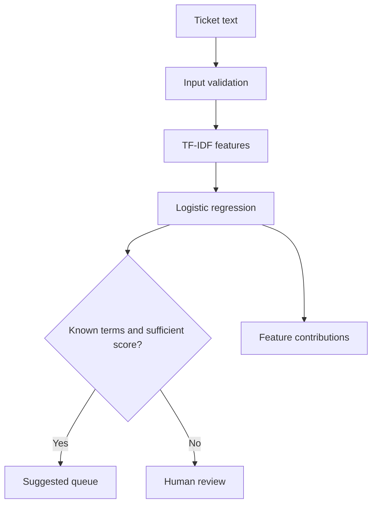

# Ticket Triage AI

Route support requests to **billing**, **account**, **technical** or **sales**, with a human-review fallback for uncertain or out-of-vocabulary inputs.

This project demonstrates an end-to-end NLP baseline: validated data, train-only text fitting, a classifier, explanations, a JSON API, a held-out evaluation and regression tests. It does not call an LLM.

## Architecture



## Try it

```sh
python app.py predict --text "My card was charged twice for the monthly subscription"
python app.py serve --port 8001
```

Send `POST http://127.0.0.1:8001/predict` with `Content-Type: application/json`:

```json
{"text":"My card was charged twice for the monthly subscription"}
```

The response contains `label`, `suggested_label`, `needs_review`, class `scores` and `supporting_terms`. `label` is null when review is needed. The probability is uncalibrated; feature contributions explain the model's linear score rather than the true reason a customer wrote the ticket.

## Evaluation

The bundled dataset contains **80 hand-authored synthetic tickets**, split into **64 training** and **16 held-out** examples. No examples come from actual customers. Exact duplicate texts and train/test text overlap are rejected. Similar vocabulary and topics still occur across the splits; this tiny set is not representative of production data.

The committed `reports/evaluation.json` records:

| Metric | Demo result |
| --- | --- |
| Classification accuracy, including suggestions sent for review | 93.75% |
| Macro F1 | 0.9365 |
| Majority-class baseline accuracy | 25.00% |
| Automatically accepted coverage at threshold 0.45 | 81.25% (13/16) |
| Accuracy on those 13 accepted examples | 100% |

The 100% subset score comes from only 13 examples and must not be presented as production accuracy. The default threshold was a fixed demo setting, not tuned using the held-out labels. Unseen but familiar-looking text can still receive a confident wrong prediction.

## Your own data

Use CSVs with `text` and `label` columns (and optionally `id`). Provide at least two classes. Replace the demo data with permissioned, de-identified support tickets and a temporally separated test set. Run:

```sh
python app.py evaluate --train path/to/train.csv --test path/to/test.csv
python app.py serve --train path/to/train.csv
```

The small classifier is trained in memory at startup; no untrusted pickle or model file is loaded. For a larger dataset, introduce versioned model artifacts and explicit deployment of validated models.

## Files

- `model.py`: preprocessing, training, prediction, abstention, explanations and evaluation.
- `app.py`: CLI and API integration.
- `api.py`: bounded local JSON server.
- `data/`: synthetic training and test CSVs.
- `tests/`: model behavior, split checks and HTTP validation.
- `reports/evaluation.json`: reproducible benchmark output.

## Next engineering milestones

1. Collect a permissioned real dataset and label ambiguous/multi-intent tickets.
2. Add stratified cross-validation on training data and a separate validation split for calibration/threshold choice.
3. Add persistence, review feedback and monitoring for class/distribution changes.
4. Compare a sentence-embedding model with this cheap, explainable baseline.

Reference: [scikit-learn LogisticRegression](https://scikit-learn.org/stable/modules/generated/sklearn.linear_model.LogisticRegression.html).

## Quick start

Tested with Python 3.12. Use a separate virtual environment for each project:

```sh
python -m venv .venv
# Windows PowerShell: .venv\Scripts\Activate.ps1
# macOS/Linux: source .venv/bin/activate
python -m pip install -r requirements.txt
python -m unittest discover -s tests -v
python app.py evaluate
```

The dependencies are pinned to the versions tested for this project, not advertised as the newest versions. After the first dependency installation, the bundled examples run offline. No paid API keys or external model downloads are needed.

The lightweight HTTP server is for local demonstrations. It binds to localhost, accepts JSON only, limits request size and does not log request bodies. Authentication, production serving, rate limiting and operational monitoring must be added before public deployment. The included GitHub Actions workflow runs tests and evaluation when pushed to a repository; that remote workflow has not run yet.
